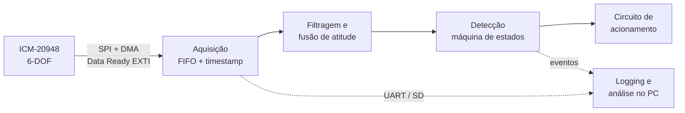

# SmartVest: Sistema de Acionamento de Airbag para Motociclistas

## Sobre o Projeto
Projeto de desenvolvimento de um sistema embarcado para acionamento de airbag em coletes de motociclistas. O sistema utiliza um microcontrolador STM32 e a unidade de medição inercial ICM-20948 (operando em 6-DOF: acelerômetro + giroscópio) para monitorar a cinemática do usuário em tempo real. Algoritmos de fusão de sensores e filtragem tratam ruído e drift, e uma lógica de detecção identifica padrões de colisão ou queda para acionar o sistema de inflação.

Este projeto tem foco acadêmico e potencial para futura pesquisa e aplicação.

## ⚙️ Decisões Técnicas
 
| Item | Decisão | Status |
|---|---|---|
| IMU | ICM-20948 | ✅ Definido |
| Graus de liberdade | 6-DOF (acelerômetro + giroscópio); magnetômetro fora do escopo | ✅ Definido |
| Comunicação com a IMU | SPI com DMA, disparado pela interrupção Data Ready (EXTI) | ✅ Definido |
| Plataforma de montagem | Protoboard (PCB como trabalho futuro) | ✅ Definido |
| Microcontrolador | STM32 com FPU (part number a definir) | ⏳ Pendente |
| Filtro de fusão | Madgwick/Mahony; Filtro de Kalman como alternativa | ⏳ Pendente |
| Taxa de amostragem | A definir com base no orçamento de latência | ⏳ Pendente |
| Atuador no protótipo | Simulado (LED, relé ou solenoide) | ⏳ Proposto |
| Rede CAN | Avaliar uso para telemetria/diagnóstico em bancada | ⏳ Reunião |
 
Decisões novas ou alteradas devem ser registradas em `docs/decisoes.md`, com data, motivo e responsável.

## Arquitetura do Sistema
 


## Requisitos Preliminares
Os valores abaixo serão fechados na reunião de kickoff e revisados após os testes iniciais (M4).
 
| Requisito | Meta | Status |
|---|---|---|
| Latência (evento → sinal de acionamento) | A definir | ⏳ |
| Perda de amostras na aquisição | Nenhuma em 10 min de operação contínua | ⏳ |
| Taxa de falsos positivos em uso normal | A definir | ⏳ |
| Taxa de detecção nos cenários de queda testados | A definir | ⏳ |
 
**Cenários positivos (devem acionar):** colisão frontal, queda lateral (*low-side*), arremesso por cima da moto (*high-side*).
 
**Cenários negativos (não devem acionar):** buracos e lombadas, frenagem brusca, vibração do motor, descer da moto, caminhar, sentar, tropeçar, colete solto ou jogado no chão.


## 👥 Divisão da Equipe
A equipe é composta por 4 membros, com supervisão ocasional do professor orientador Dario. Cada frente tem um responsável principal, mas as frentes trabalham em paralelo e se apoiam mutuamente. Um frente não significa especificamente que o responsavel só tera atribuições de atividades relacionadas a mesma, mas sim que esse ´[e o responsavel por validar e coordenar as atividades dessa frente.


| Frente | Responsável | Principais entregas |
|---|---|---|
| **Engenharia de Firmware & Controle** | _(Wesley)_ | Projeto STM32, driver SPI/DMA do ICM-20948, interrupções, logging, integração dos módulos |
| **Processamento de Sinais & Algoritmos** | _(João)_ | Modelagem hipotética da detecção, filtro de fusão, porte do algoritmo para C, análise de FP/FN |
| **Hardware & Eletrônica de Potência** | _(Lourenço)_ | Montagem em protoboard, circuito de acionamento do atuador, esquemático documentado |
| **Testes & Integração** | _(Ludimila)_ | Protocolos de teste, bancada de ensaios, coleta e rotulagem de dados, medição de latência |
| **Supervisão** | _(professor)_ | Revisões nos checkpoints do cronograma |


## 🎯 Milestones (Marcos do Projeto)
O detalhamento semanal está em [`docs/CRONOGRAMA.md`](CRONOGRAMA.md).
 
### M1: Setup e Aquisição de Dados (02/11 – 13/11)
Configuração do ambiente STM32, comunicação com a IMU e leitura bruta (raw) dos dados de aceleração e rotação.
- [ ] Comunicação SPI validada
- [ ] Faixas de medição e taxa de amostragem configuradas
- [ ] Aquisição não-bloqueante via EXTI + DMA, com timestamp por amostra
- [ ] Logging para o PC sem perda de amostras em 10 min
- [ ] Primeiras capturas brutas (repouso, rotações manuais, vibração)

### M2: Processamento e Filtragem (09/11 – 20/11)
Implementação e calibração dos filtros de ruído da IMU para obter orientação e aceleração linear confiáveis.
- [ ] Calibração de offset (bias) do acelerômetro e do giroscópio
- [ ] Filtro de fusão implementado utilizando a FPU
- [ ] Atitude estável em repouso, com drift avaliado
- [ ] Tempo de execução do filtro medido no microcontrolador

### M3: Algoritmo de Detecção (02/11 – 25/11)
Modelagem hipotética dos limiares (thresholds) e da lógica de detecção, complementada ou substituída por dados obtidos em ensaios, além da demarcação do escopo dos testes preliminares.
- [ ] Modelagem hipotética documentada (limiares e máquina de estados)
- [ ] Coleta de dados de ensaio para complementar a modelagem
- [ ] Algoritmo portado para C e testado contra logs gravados no PC
- [ ] Escopo e protocolo dos testes preliminares definidos

### M4: Testes Iniciais (23/11 – 28/11)
Testes preliminares para validar a modelagem do algoritmo de detecção e o setup de aquisição de dados.
- [ ] Protocolo de testes preliminares executado
- [ ] Comparação entre comportamento esperado e observado
- [ ] Ajustes na modelagem registrados

### M5: Análise de Performance (26/11 – 01/12)
Análise de latência e de falsos positivos e negativos.
- [ ] Latência ponta a ponta medida (GPIO + osciloscópio/analisador lógico)
- [ ] Matriz de falsos positivos/negativos por cenário de teste
- [ ] Relatório de análise de performance

### M6: Desenvolvimento do Hardware (09/11 – 03/12)
Integração da lógica com o circuito de potência em protoboard, validando o sistema por completo como prova de conceito.
- [ ] Circuito de acionamento montado e testado isoladamente
- [ ] Integração do circuito com o firmware
- [ ] Esquemático documentado em `hardware/`

### M7: Testes e Validação do Protótipo Final (01/12 – 06/12)
Ensaios práticos de bancada e elaboração da documentação final, que servirá de base para submissão a bolsas de pesquisa.
- [ ] Ensaios de bancada com o sistema integrado
- [ ] Documentação final (README, relatórios e vídeo de demonstração)
- [ ] **Entrega do protótipo: 06/12/2026**

## 🔄 Gestão do Repositório (Git Workflow)
Adotamos um fluxo baseado no **GitFlow** para manter a organização do código:
*   `main`: Código estável, testado e funcional. Protegida contra commits diretos.
*   `develop`: Branch principal de integração de desenvolvimento.
*   `feature/nome-da-funcionalidade`: Branches criadas a partir da `develop` para desenvolver novos recursos (ex.: `feature/imu-spi-dma`).
*   `bugfix/nome-do-bug`: Branches para correção de erros não críticos.
Todo merge na `develop` deve passar por Pull Request com revisão de pelo menos um outro membro.
 
**Padrão de Commits:** commits semânticos, usando os tipos `feat`, `fix`, `docs`, `test`, `refactor` e `chore` (ex.: `feat: configura SPI do STM32`, `fix: corrige overflow na leitura do giroscópio`, `docs: atualiza pinout no README`).
 
**Gestão de tarefas:** cada atividade do cronograma vira uma Issue, vinculada ao Milestone correspondente e acompanhada no GitHub Projects (quadro Kanban).
 
## 📁 Estrutura do Repositório
```
firmware/      Projeto STM32 (drivers, aquisição, filtro, detecção)
algorithms/    Modelagem em Python, notebooks e scripts de análise
data/          Logs brutos e rotulados dos ensaios
hardware/      Esquemáticos, lista de componentes e fotos da protoboard
tests/         Protocolos de teste e resultados
docs/          Requisitos, registro de decisões e relatórios
